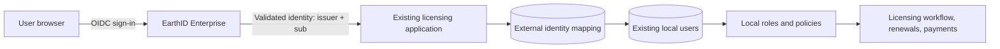

# Case study: adding EarthID SSO to an existing licensing portal

**Illustrative scenario only.** This is a fictional, vendor-neutral reference case for an older permitting/licensing system. It is **not** a description or endorsement of any named customer's deployment.

**Principle:** EarthID Enterprise authenticates. The application retains its local user mapping and **enforces business authorization**. See [AuthN vs AuthZ](../guides/authentication-vs-authorization.md), [Best Practices](../guides/best-practices.md) and the [FAQ](../guides/FAQ.md).

## The starting position

A software vendor maintains a licensing application used by agency staff and applicants. The application is several years old and may run on a legacy web stack. It already has:

- its own application `user_id` and local account table;
- staff users, supervisors, applicants and operational roles;
- application data: applications, renewals, payments and approvals;
- a local sign-in page and existing password-based session;
- an approaching deployment, with limited time for risky changes.

The agency introduces **EarthID Enterprise** as its shared identity provider. The vendor asks: “Once the user signs in through EarthID, must they sign in again to my existing system? What happens to the old user IDs and roles? Does the login expire?”

### Outcome we want

**One sign-in for the user, existing business permissions for the application.** Keep the current business database and roles. Add an association between the verified EarthID identity and the existing local user. After an approved one-time association, future EarthID logins automatically resolve to that user.

## Before and after

| Journey | Previously | With EarthID integration |
| --- | --- | --- |
| Returning staff member | Opens portal -> enters portal username/password -> dashboard | Opens portal -> EarthID authentication or active SSO -> existing dashboard |
| Staff member's application identity | `user_id=246` | Still `user_id=246`; external `issuer + sub` mapping points to it |
| Approval permissions | Local role/policy determines who can approve | **Unchanged**; same local role/policy |
| New staff member | Admin creates local user | Admin still provisions/approves local user, then maps EarthID identity through a controlled process |
| Expired local session | Prompts local login again | Redirect to EarthID; reauthentication depends on SSO session/policy |
| Disabled local user | Local login blocked | Must also be blocked **after valid EarthID authentication** |

The user should **not** enter a second application password on every successful EarthID login. That would defeat the SSO experience.

## Architecture

EarthID establishes **who authenticated**. The application establishes **which existing user ID this is**, whether that local account is active, and **what actions that user may perform**.

## Scenario 1 — returning staff user with an approved mapping

**Example only:**

- User's existing local ID: `246`
- Local role: `licence_officer`
- EarthID external subject: an opaque `sub`, scoped to a particular `issuer`
- Unique mapping: `(issuer, sub) -> local_user_id 246`

**Flow:** User opens a protected renewal application -> your application redirects to EarthID -> EarthID authenticates -> your backend validates the OIDC callback -> local user `246` is found and confirmed active -> your application creates its own secure session -> user continues the renewal.

**Result:** No additional app password; the user keeps their existing permissions, work history and data links. The application logs the action against its existing local user ID.

## Scenario 2 — first-time EarthID sign-in, existing local account

There is an EarthID identity but no matching local mapping. The user must **not** be silently mapped based only on a similar email, display name or NRIC.

**Preferred safe options:**

- An approved administrator pre-links a known local account after checking identity through an authorized channel; or
- The user performs a **one-time** existing-account proof/step-up flow, after which the unique external association is stored.

**Result:** First-time linking is recorded and audited. At the **next** EarthID sign-in, the lookup is automatic. The one-time link is not equivalent to forcing the user to maintain two daily logins.

**Failure path:** If multiple local accounts appear to match, or ownership cannot be proven, do not auto-select. Send to authorized review and deny staff privileges until resolved.

## Scenario 3 — local account disabled or role changed

A staff member may still have an active EarthID SSO session even after the business administrator revokes their role or disables their local account.

**Flow:** EarthID authenticates -> application resolves the mapping -> application sees `disabled` or lacking the required permission -> **denies access**.

**Result:** EarthID authentication **cannot override** a disabled local account. Local authorization stays authoritative for the licensing workflow.

## Scenario 4 — new applicant with no existing account

Business requirements determine the next action.

- If the person needs to track multiple ongoing applications: the portal may provision a new, **least-privilege applicant** account under approved registration rules.
- If the person needs only one isolated identity check (for a form, appointment or declaration): consider the **separate [MyKad Verification API](../verification/mykad/README.md)** without creating an account or general app session.

**Never create an officer or administrator account as a side effect of external login.**

## Scenario 5 — annual licence renewal

An existing applicant returns months later to renew a licence. Their app session and previous OIDC tokens have expired, but the **saved external identity-to-local-account mapping** remains valid unless revoked.

**Flow:** User opens renewal -> application redirects to EarthID -> user authenticates if required -> application re-resolves the mapping -> application enforces current licence ownership and renewal eligibility -> user proceeds.

**Important:** Identity authentication does not itself prove that the user is the current licence holder or authorized representative. The **business application** still checks those records.

## Scenario 6 — session timeout, logout and repeat authentication

There is no single universal “EarthID ID expiry” value.

| Component | Who governs it | User-facing behavior |
| --- | --- | --- |
| EarthID SSO session | Implementing organization | May allow single sign-on or require authentication again |
| OIDC tokens | Issuer/client policy | Expire and are handled by the authentication integration |
| Application session | Licensing system | May time out independently; protected actions require revalidation |
| Identity mapping | Application user registry | Continues until administratively revoked or migrated |
| Local role/permissions | Application | May be changed immediately, even during a valid session (enforce policy) |

A valid EarthID sign-in does **not** mean the user must manually sign in to the local app again; it means the app creates its own short-lived session **programmatically**.

**Logout is separate:** clearing a local session is not necessarily central EarthID SSO logout. Choose and test the required behavior.

## What the vendor needs before implementing

1. The real EarthID **Issuer URL** supplied by the implementing organization; the fictional `https://earthid.organization-domain.com` is only a format illustration.
2. A registered **Client ID** and **Client Secret** for a confidential server-side app (or a public Client ID without a secret for an approved SPA).
3. Exact application callback URL, scopes and organization-provided logout/session policy.
4. The application's existing user table and identifier, active/disabled flag and role/permissions model.
5. Agreed **one-time linking policy**: who is allowed to link, how identity and old-account ownership are verified, and what to do with duplicate records.
6. Pilot users for a mapped staff member, an unmapped staff member, a disabled user and an administrator.
7. A staging environment, a rollback plan and deployment owner.

**The guide does not require the vendor to abandon their existing stack.** Whether the old system is a legacy PHP website, ASP.NET application or modern frontend, the responsibilities and security gates are the same. Choose the relevant [framework guide](../README.md).

## Minimum UAT evidence before deployment

| Test | Expected |
| --- | --- |
| Existing mapped staff | Single EarthID login -> local dashboard, without second login |
| Unlinked staff | Controlled linking/review; no accidental auto-link |
| Linked account, second visit | Resolved automatically; same local user ID |
| Disabled account | Denied even when EarthID login succeeds |
| Staff role reduced | Business actions now restricted |
| New applicant | Least-privilege account **only if** product policy allows |
| Annual renewal | Requires current business entitlement, not just a verified identity |
| Session expired | Safe reauthentication, preserving requested internal route |
| Logout | Local vs global SSO behavior documented and tested |
| System deployment | Secrets, callback, proxy headers, cookies, audit and rollback verified |

## Decision summary

**Adopt EarthID for authentication. Keep the local user for authorization. Link them once, securely. Don't force two passwords every time.**

Additional material: [Existing-app integration guide](../guides/existing-app-sso.md) · [Vendor readiness checklist](../guides/vendor-readiness.md).
