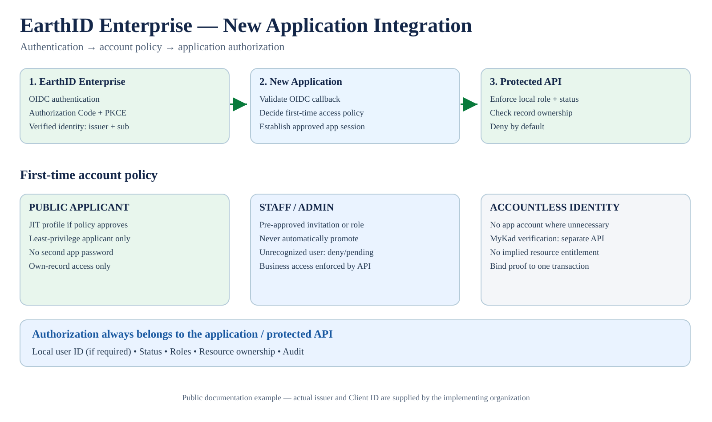

# Case Study — Building a New Public Service Portal with EarthID Enterprise

**Fictional, organization-neutral example.** This case study illustrates a *newly developed* public-facing application for submitting requests and tracking their status. There is no existing application account database to migrate.

The public may submit a request, while designated staff review, approve or reject requests. EarthID Enterprise provides authentication; the application provides its own business workflow, data model and authorization.

## Architecture at a glance



## 1. Product requirements

| Role | Primary work | Entry rule |
| --- | --- | --- |
| Public applicant | Submit a request, check status, update own draft | Sign in via EarthID; minimal applicant record may be created **if JIT is approved** |
| Reviewer | Inspect and comment on assigned applications | EarthID sign-in **and** preapproved local staff profile |
| Approver | Approve or reject requests | EarthID sign-in **and** role, jurisdiction and separation-of-duties checks |
| Application administrator | Manage app user roles and configuration | EarthID sign-in, explicit privileged local grant and stronger controls |

**Do not treat an arbitrary authenticated user as an employee.** The IdP confirms that somebody authenticated, not that they work for this organization or hold a business role.

## 2. Design decisions made before coding

- **Single application sign-in:** EarthID OIDC Authorization Code Flow + PKCE. No separate app password for routine sign-in.
- **Distinct application user ID:** local ID used for submissions, audit and workflow assignment.
- **Identity key:** exact validated pair `(issuer, sub)`.
- **Public enrolment:** approved JIT creation of a least-privilege `applicant` local user; **never** automatically assigns staff/admin permissions.
- **Staff enrolment:** invite/preapprove in the application. First login of an unapproved person returns **Pending access** or **Access denied**.
- **Access decisions:** API applies status, current role, resource ownership, assignment and process state.
- **Profile:** shows provider, account status and app role. No Associate/Unlink controls when EarthID is the only supported identity provider and no alternative recovery exists.

## 3. First applicant journey

```mermaid
sequenceDiagram
  autonumber
  actor Citizen as Applicant
  participant App as Public Service Portal
  participant IDP as EarthID Enterprise
  participant DB as App Database
  Citizen->>App: Start new request
  App-->>Citizen: Sign in with EarthID
  Citizen->>IDP: Authenticate
  IDP-->>App: Authorization code
  App->>IDP: Exchange with PKCE; validate response
  App->>DB: Find (issuer, sub)
  alt First time and applicant JIT is approved
    App->>DB: Atomically create local applicant
  else Returning applicant
    DB-->>App: Existing active app user ID
  end
  App-->>Citizen: Create application session
  Citizen->>App: Submit request
  App->>DB: Verify applicant owns submitted draft
  App->>DB: Save request and audit actor_user_id
  App-->>Citizen: Request reference number
```

**What the applicant sees:** an EarthID login, then the portal. There is no second username/password screen or legacy account association.

**What the app stores:** local user ID, external `issuer + sub`, account status, application records, audit and the minimum approved user details. It must not store unnecessary tokens as a permanent user profile.

## 4. First staff journey

1. An administrator preapproves a staff profile, an app-specific invitation or another controlled external-to-local mapping.
2. Staff visits the portal and signs in via EarthID.
3. The app validates the OIDC response and checks approved staff eligibility and current local account status.
4. If approved, the app opens the reviewer dashboard with its own local role and record access.
5. If not approved, the app shows a clear **Access pending** page. It does **not** create a staff account with default privileges.

**Counterexample:** A person signs in successfully using EarthID, navigates to `/admin` and submits `POST /api/requests/123/approve`. Even with valid SSO, the API **must deny** the action unless local authorization allows it.

## 5. Returning users, session expiry and account status

- Returning applicants resolve the **same local user ID**. Do not create a duplicate every time the identity provider authenticates them.
- If the local session expires, redirect to EarthID again. An active SSO session may avoid a fresh password prompt, depending on IdP/browser policy.
- Disabling an application user must stop application access, even if EarthID's SSO session is still active.
- If an applicant later becomes a reviewer, the role change follows a **separate approved local authorization workflow**. It is never a consequence of having authenticated.
- Application logout clears its session. Global SSO logout must be separately supported and tested.

## 6. Recommended profile layout

```text
My Profile
  Sign-in Provider    EarthID Enterprise
  Identity            e***@organization-domain.com
  Application Role    Applicant
  Account Status      Active
  Sign out            [Button]

  Your sign-in is managed through EarthID Enterprise.
  This application manages your requests and access permissions.
```

A new EarthID-only app generally **does not need** the legacy-app **Associate/Re-associate/Unlink** feature. If you add multiple identity methods later, design a secure account recovery and replacement flow before exposing linking controls.

## 7. Testing scenarios

| Test | Result required |
| --- | --- |
| First public login | Exactly one local applicant user created under approved policy |
| Same user returns | Same local user ID and existing requests |
| Unknown user enters staff route | Access denied or pending; no privileged JIT |
| Applicant opens another person's request | API denies |
| Reviewer accesses unassigned record | API denies unless explicitly permitted |
| Staff account disabled | API denies despite valid EarthID authentication |
| Profile claim \`email\` missing | Use verified `issuer + sub`; avoid identity failure based on optional display fields |
| Two simultaneous first logins | Atomic uniqueness prevents duplicates |
| Privileged action | Current role, scope, ownership/workflow checks and audit enforced |
| IdP unreachable or invalid callback | No unauthorized or default-user bypass |

## 8. New versus existing application

| | New application | Existing/legacy application |
| --- | --- | --- |
| Local user database before integration | Not necessarily | Already present |
| First-time local identity step | Decide approved JIT, invitation or no local record | Securely link to **existing** local account |
| Old password prompt | None necessary | Can be replaced for returning linked users |
| Associate/Re-associate/Unlink profile UI | Usually unnecessary for EarthID-only app | Often valuable, with recovery safeguards |
| Business authorization | Must design now | Preserve and verify existing permissions |
| SSO registration | Organization issues appropriate OIDC client | Organization issues appropriate OIDC client |

## Implementation references

- [New Application Integration Guide](../guides/new-application-sso.md)
- [Authentication vs Authorization](../guides/authentication-vs-authorization.md)
- [Best Practices](../guides/best-practices.md)
- [Existing / Legacy Application Case Study](legacy-licensing-portal.md)
- [Vendor Readiness](../guides/vendor-readiness.md)

This case is **illustrative architecture**, not evidence that a real application, local account provisioning API, role model or policy endpoint has been deployed. The implementing organization must approve actual identity and application governance decisions.
