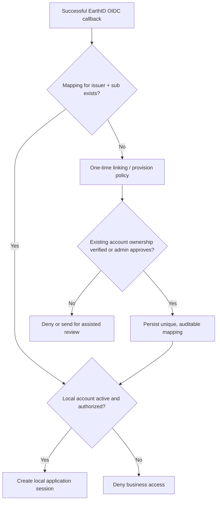

# Integrating EarthID Enterprise into an existing application with local users

**Audience:** developers whose application already has a `users` table, existing login form, departmental/operational roles, authorization rules and business records. The application may be an older PHP system, ASP.NET application, modern web application or a frontend with a protected API.

**Goal:** adopt EarthID Enterprise for authentication **without discarding the existing local user database** or requiring users to re-enter the application's password on every login.

Before changing your application's login flow, read [Authentication vs Authorization](authentication-vs-authorization.md), [Best Practices](best-practices.md) and the [FAQ](FAQ.md). In short, EarthID handles user authentication, while your application handles local identity mapping and business authorization. Central access-governance roles may be delegated under an explicit contract, but they do not automatically replace local record-level permissions.

## 1. Answer the question: after EarthID login, must the user log in again?

**No, not as the normal experience.** After a successful EarthID callback, your application must:

1. Verify the OIDC response using a trusted framework/library (Authorization Code + PKCE, state/nonce, signing keys, exact issuer and client audience).
2. Read the externally assigned **`issuer` + `sub`** pair, not just the person's name or email.
3. Find the matching record in **your application's local account mapping**.
4. Check the local account's status and policies.
5. Create **your own secure application session** associated with the existing local user ID.
6. Continue directly to the requested protected page, preserving a validated local return URL.

The user signs into EarthID Enterprise, then enters the business application. **A local account still exists in the background**, but no second password prompt is required after an approved mapping is established.

### First-time sign-in: the one-time linking exception

If there is **no mapping yet**, do **not** silently grant access and do **not** auto-link a local account merely because the email, name or NRIC looks similar. An untrusted identity match can become an account-takeover vulnerability.

Choose one **controlled** approach based on the system's risk:

- **Existing account holder:** one-time proof of control of the old application account (for example, existing password plus any required step-up verification). Then store the approved EarthID identity association.
- **Administrator-led migration:** an authorized administrator pre-maps a known staff account using an auditable, independently verified process.
- **New applicant:** apply an explicit, minimal registration/provisioning policy. Do not assign a staff or privileged role merely because an EarthID login succeeded.
- **Uncertain match:** stop access, offer an assisted linking/review path. Never automatically choose from duplicate emails or personal data.

**If the old system has no usable local credentials**, an administrator-reviewed account linking process is safer than guessing based on matching personal attributes. “One-time linking” is a business decision and implementation step, **not a feature that OIDC performs automatically**.

### Let users see and manage their existing association

**Recommended for legacy integration:** add a clearly labeled **Linked EarthID Account** section to the local user's **Profile / Account Settings** page. The section should show:

- **Status:** Linked / Not linked / Pending review;
- **Provider:** EarthID Enterprise;
- **Linked identity:** a masked display hint when an approved claim is available;
- **Actions:** Associate, Re-associate, and/or Unlink **only where server-side security/recovery policy permits**.

This reduces confusion about which EarthID account signs into which local user. **Re-association requires both local-account ownership proof and verified authentication of the new EarthID identity.** Do not expose unrestricted self-service unlink if EarthID is the user's only sign-in method.

See the [user-facing account linking management guide](linked-account-profile.md) for the UI, callback flow, re-link safety and acceptance tests.

## 2. End-to-end login sequences

### A. Returning user: automatic sign-in to the local application

```mermaid
sequenceDiagram
  actor U as User
  participant A as Existing application
  participant E as EarthID Enterprise
  participant D as Application user database
  U->>A: Open protected page
  A-->>U: Redirect to EarthID
  U->>E: Authenticate (or reuse valid SSO session)
  E-->>A: Authorization code at registered callback
  A->>E: Code exchange / OIDC validation
  A->>D: Resolve external (issuer, sub)
  D-->>A: Existing local user ID + status + permissions
  A->>A: Enforce active status; issue local session
  A-->>U: Open original protected page
```

No additional application login is needed. Existing app roles remain effective. A disabled local account must be denied **even when EarthID authentication succeeds**.

### B. First-time user: one-time approved linking



**Do not implement a “link any existing user ID” form that trusts only a selected username.** The person must prove ownership of that local account or an administrator must approve the association through a controlled workflow.

### C. App route after SSO login

Authentication is a **precondition**, not an authorization grant. A valid session may open a dashboard but does not entitle that person to view another applicant's licence, approve a payment, or administer staff.

## 3. What stays in your existing system?

| Responsibility | Owner |
| --- | --- |
| Authentication, identity federation, SSO | **EarthID Enterprise** |
| OIDC issuer, client registration, approved claims | **Organization operating EarthID Enterprise** |
| Application user ID and existing user table | **Your application** |
| User roles, department assignment, account enabled/disabled | **Your application** (unless an explicit delegated-authority design is agreed) |
| Licence, case, application, billing and transaction records | **Your application** |
| Password for old/local fallback login | **Your application's owner**; phased retirement is optional |
| Business audit events: who approved or changed a record | **Your application** |
| Optional identity claims from MyDigital ID | Only as actually granted by the deployed EarthID client configuration |

**Local user management and SSO are not competitors.** An application can stop asking its normal users for a password while still maintaining its own local accounts and permissions.

## 4. Database model: map external identity to existing local user

Conceptual example for a new `user_external_identities` mapping table:

```sql
CREATE TABLE user_external_identities (
  id BIGINT GENERATED ALWAYS AS IDENTITY PRIMARY KEY,
  local_user_id BIGINT NOT NULL,
  issuer VARCHAR(512) NOT NULL,
  subject VARCHAR(512) NOT NULL,
  linked_at TIMESTAMP NOT NULL,
  linked_by VARCHAR(128) NOT NULL,
  UNIQUE (issuer, subject)
);
```

Adapt SQL dialect, foreign key, indexing, audit design, and whether multiple external identities per local user are permitted to your database policy. `issuer` and `subject` are **opaque strings**, not MyKad numbers. The UNIQUE constraint prevents one external identity from resolving to multiple local users. The application should also explicitly govern whether a local account can have more than one external identity.

Suggested audit data: local user ID, issuer, opaque subject or protected reference, approved linking method, approver, timestamp, and unlink/relink events. Do not log raw tokens, secrets, full NRIC or unauthorized personal attributes.

### Callback integration pseudocode

```text
claims = oidcLibrary.validateAndExchangeAuthorizationCode(callback)
externalKey = (claims.issuer, claims.sub)   # stable within the issuer's rules

mapping = db.findExternalIdentity(externalKey)
if mapping is missing:
    return startApprovedOneTimeLinkingFlow()

user = db.getLocalUser(mapping.local_user_id)
if user is missing or user.disabled:
    denyAccess()

session.rotateIdentifier()
session.signInAs(user.id)     # Local session, not a second local login screen
redirectTo(safeRelativeReturnUrl)
```

Do not treat the pseudocode as a complete authorization subsystem. Every protected endpoint must independently check `user.id`, account status and permissions.

## 5. Expiry: is EarthID login permanent?

**No.** “User ID,” “IdP session,” “OIDC token” and “local app session” are different things.

| Item | What happens when it expires? |
| --- | --- |
| Local **user ID** | Doesn't expire merely because a login token expires; remains governed by the application account lifecycle |
| Saved **issuer + sub mapping** | Normally retained until the link is revoked, migrated or audited; never inferred from an expired token |
| EarthID browser SSO session | May prompt authentication again when it ends or policy requires fresh login |
| Authorization code | One-time, short-lived; exchanged during callback |
| ID/access tokens | Expire according to the issued claims and EarthID configuration; must not be treated as permanent |
| Your **application session cookie** | Expires according to your application's own timeout/revocation policy |

If the **application session** expires while the **EarthID SSO session** remains valid, the application can initiate another OIDC redirect. The user may be returned without entering credentials, subject to browser and IdP policy. If the EarthID session has expired, authentication is required again. **Session timeout is not the same as being forced to link the local user again.**

The implementing organization must provide actual token/session policy and available logout behavior; this guide does not invent fixed lifetime values. For sensitive operations, enforce application inactivity timeouts and fresh authentication/step-up where appropriate.

## 6. Optional MyDigital ID sign-in versus one-time verification

- **SSO through EarthID:** your user signs in via the organization's available authentication methods (which may include MyDigital ID). The application resolves their local account and creates an application session.
- **MyKad Verification API:** user completes MyDigital ID identity verification for one transaction, receiving a signed verification result. That **does not automatically log the user into your existing account system**.

Do not substitute the MyKad Verification API for OIDC SSO when the feature requires a persistent logged-in staff/application account. See [accountless verification guide](../verification/mykad/README.md).

## 7. Existing local login and emergency access

A legacy system may need a parallel local administrator path during rollout or for designated emergency accounts. Define it explicitly, protect it with appropriate MFA, rate limits and audit logs, and restrict it to authorized operators. Do not casually create a universal bypass.

Possible rollout phases:

1. Keep existing local login working while testing the OIDC client.
2. Enable EarthID for a small, approved pilot group.
3. Prove one-time linking and subsequent automatic lookup.
4. Verify every role and disabled-user scenario.
5. Decide whether the old login is retained, restricted or retired, with a documented rollback plan.

## 8. Vendor acceptance criteria

A vendor has **not finished integration** just because the EarthID login page appears. Minimum required proof:

- Existing mapped user: EarthID sign-in -> protected app page **without a second password**.
- First-time user: controlled one-time linking; subsequent sign-in does not repeat linking.
- Unmapped or disabled staff: denied privileged access.
- Local role changes: affect business permission without changing EarthID identity.
- Session expiry: repeat OIDC flow without losing the requested safe internal route.
- No email-only/NRIC-only auto-linking; no open redirects.
- Local logout and SSO-wide logout behavior separately documented and tested.
- Old application and privileged fallback paths tested against regressions.

See the [Linked Account profile UX guide](linked-account-profile.md), [fictionalized licensing portal case study](../case-studies/legacy-licensing-portal.md) and [vendor delivery checklist](vendor-readiness.md).
