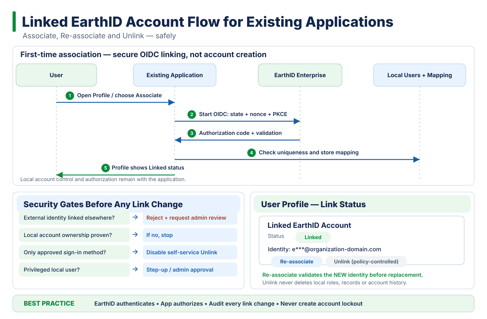
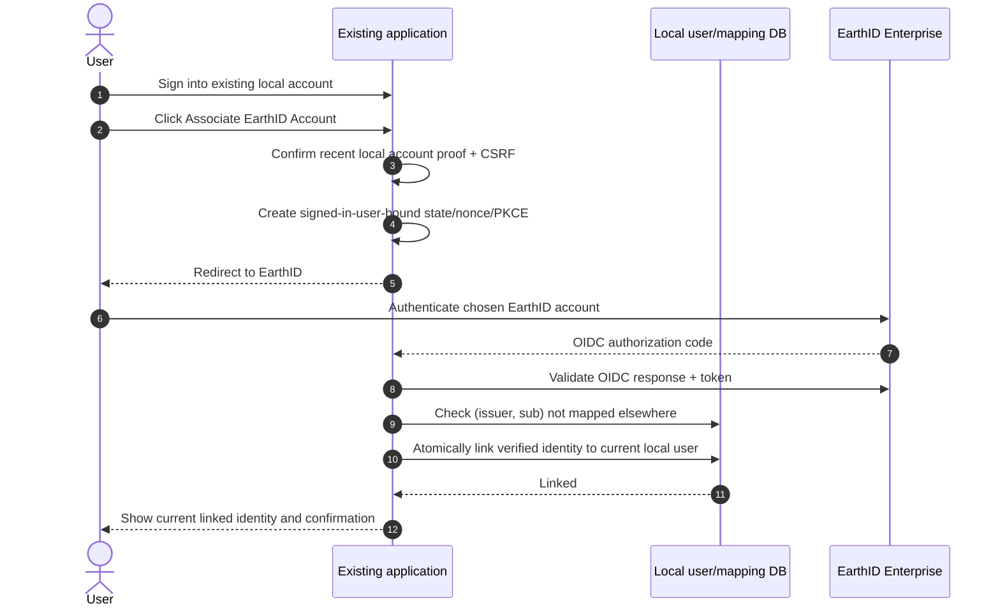

# Linked EarthID Account — User Profile UX for Existing Applications

**Audience:** developers integrating EarthID Enterprise into an **existing / legacy application** with its own user records, permissions and account management.

**Recommendation:** Give users a visible **Linked EarthID Account** section in the application's existing **User Profile / Account Settings** page. Show which external identity is associated with their **local application account**, and provide appropriately protected **Associate**, **Re-associate** and **Unlink** actions **where the application's access-recovery policy allows them**.

**This is an application feature, not proof that EarthID Enterprise exposes a generic remote account-linking API.** The application implements the UI and stores its own `(issuer, sub) -> local_user_id` mapping. EarthID performs authentication of the external identity via OIDC.

No real organization, customer identity, profile screenshot, email address or deployment detail is reproduced in this public guide.

## Visual guide: Linked EarthID Account flow



The illustration shows the recommended user journey and security gates. The **vendor application**, not a generic EarthID remote account-linking endpoint, stores and manages the local identity mapping.

## 1. Why this UI matters

After legacy SSO migration, people otherwise cannot answer:

- **Which EarthID identity is linked to this existing account?**
- If I sign in with EarthID, **which local user ID, role and data will I receive?**
- Did the one-time association succeed?
- What can I do if I accidentally linked the wrong identity?
- Will unlinking remove my local user, permissions, application records or history?
- Can I still sign in if I unlink the **only** login method?

**Goal:** make the association **visible, explainable, auditable and safely manageable**, instead of hiding it entirely in a database table.

## 2. Recommended profile design

The local profile already displays the application's own identity and role, followed by a separate identity-linking panel. Example layout, **fictional data**:

```text
User Profile
----------------------------------------------------------
Local Account
  User ID:         246                       [read-only]
  Username:        example.officer
  Display Name:    Example Officer
  Current Role:    Licensing Officer        [app-managed]
  Account Status:  Active                   [app-managed]

Linked EarthID Account
  Status:          Linked
  Provider:        EarthID Enterprise
  Linked Account:  e***@organization-domain.com
  Linked On:       17 Nov 2026              [if recorded]
  Last SSO Login:  17 Nov 2026              [if recorded]

  [Re-associate EarthID Account]  [Unlink EarthID Account]

  EarthID authenticates your identity.
  This application manages your role and business access.
  Changes to this link do not delete your application account.
----------------------------------------------------------
```

If **not linked**, show **Not linked** and an **Associate EarthID Account** action rather than Re-associate/Unlink. If linkage is pending approval, say **Pending review**. If data is inconsistent, fail closed and show **Contact administrator**.

### Field guidance

| Item | Source | Notes |
| --- | --- | --- |
| **Local User ID** | Application database | The identity used by legacy roles, transactions and audit records; not EarthID's `sub` |
| **Local Role / Account Status** | Application | This is **authorization**; must not be silently overwritten from the IdP |
| **Link Status** | Application identity mapping | Show Linked / Not linked / Pending / Attention required based on actual server state |
| **Identity Provider** | Approved client configuration | `EarthID Enterprise`; avoid displaying untrusted provider labels |
| **Linked Account** | Trusted, previously verified OIDC display claim when available | A **masked** name or email is a display hint; email is **not** the unique linking key; claims may change |
| **Linked At / Last SSO Login** | Application audit metadata | Show only if actually recorded; don't infer it from page load time |
| **External Subject / Issuer** | Verified OIDC identity | Persist securely as `(issuer, sub)`. Avoid exposing raw identifiers by default |

If the IdP did not grant an email/name claim, use **“Identity linked — display details unavailable”** instead of fabricating one. Do not display Client Secrets, raw tokens, NRIC or sensitive identity attributes.

## 3. Account linking states and allowed actions

| State | User-facing message | Available action |
| --- | --- | --- |
| **Not linked** | “No EarthID account is linked to your application account.” | **Associate** (after current-account proof) |
| **Linked** | “Your application account is linked to EarthID Enterprise.” | **Re-associate**, **Unlink** only if policy permits |
| **Pending approval** | “Your linking request is pending verification.” | View status / cancel if permitted |
| **Conflict** | “This EarthID identity is already linked to another local account.” | Reject; guided administrative review |
| **Access recovery required** | “Unlinking would remove your only sign-in method.” | **Disable Unlink** and explain approved recovery |
| **Disabled local account** | “This local account cannot access the application.” | No self-service linking to bypass disablement |

**Default recommendation for higher-risk staff/admin apps:** Do **not** allow unrestricted self-service re-association or unlinking. Require an administrator or dedicated account-recovery process for privileged identities.

## 4. Associate — first-time linking

The user must be **signed in to the correct local account** and prove control of that account. For a legacy system, this might be the existing password plus appropriate MFA, or an independently approved administrator-led mapping. **Never let an EarthID-authenticated stranger choose an arbitrary local user ID.**



**Security invariants:**

1. Use the current authenticated **server-side local user ID**, never one provided in a query string or hidden input.
2. Use the usual secure OIDC Authorization Code + PKCE, `state`, `nonce`, issuer, audience, signature and expiry checks.
3. Bind the one-time linking request to the **same local session and account** that initiated it; reject replay, expiry and session switching.
4. Reject linking an external `(issuer, sub)` already associated with a different local user.
5. Write the link within a database transaction guarded by a unique `(issuer, sub)` constraint.
6. Store only the approved mapping and minimal display/audit fields. Do not store raw ID/access tokens just to show a profile badge.

**Important:** An ordinary successful EarthID login can reuse an existing IdP SSO browser session. The linking UI should prominently **confirm the identity about to be linked**, and where needed request a supported account-selection or fresh-authentication policy from the provider. Never assume that every deployment supports an account chooser or that `prompt=login` alone proves the original local-account holder.

## 5. Re-associate — changing which EarthID account is linked

Re-association is **sensitive account recovery** because it can permanently change which external identity opens an existing local user's records.

**Safe sequence:**

1. Require **recent, strong proof of control of the existing local account**. Apply administrative approval for privileged users when required.
2. Show the **current** linked identity (masked) and warn that the new identity will be used for future SSO.
3. Initiate a **new** EarthID authentication transaction to verify the target identity.
4. Check the new `(issuer, sub)` is not linked to a different local account, and that mapping policy allows replacement.
5. Present a confirmation before committing: **“Replace your linked EarthID identity?”** with masked old/new identity display if available.
6. **Atomically** replace the link. Do **not** delete the old link before the new identity is validated and replacement is committed.
7. Audit old and new references, method, actor and time; notify the account holder through an approved channel without sending tokens.
8. Revoke or re-evaluate active app sessions as your threat model requires (especially administrative accounts).

**Wrong account selected:** cancel without changing the original link. If the target is linked to another user, reject; don't allow a “force move” from self-service UI.

## 6. Unlink — protecting the user from lockout

A self-service **Unlink** button is **not always safe**.

- Verify that the user retains a **working, approved alternative sign-in / recovery method**, or require administrator-mediated recovery.
- For an **EarthID-only account**, normally **disable self-service unlink** (or require a controlled replacement-link flow); don't orphan the only valid login method.
- For privileged accounts, require recent authentication/step-up and sometimes dual approval.
- Ask for explicit confirmation: “Unlinking stops future sign-in with this EarthID identity. It does **not** delete your local account, roles or business data.”
- Use a **POST** with CSRF protection and authorization, not a state-changing GET.
- Remove only the identity mapping under an atomic operation. Record an audit event and notify the user.
- Define whether current app sessions should be terminated or re-authenticated. **Unlink is not the same as global EarthID logout.**
- Retain protected audit records according to policy; do not expose or delete business history.

**A re-association flow is generally safer than a free-standing Unlink button** if EarthID is the expected primary sign-in method.

## 7. Account identity model and access control

At minimum, the application owns:

```text
local_users
  id (application's stable user ID)
  username / display_name
  status
  app_role ...                   <-- business authorization

user_external_identities
  local_user_id                  <-- reference to existing local user
  issuer                         <-- OIDC issuer; exact
  subject                        <-- OIDC sub; opaque
  linked_at
  linked_by / linking_method
  last_sso_login_at (optional)
  linked_display_hint (optional, masked for UI)
  UNIQUE(issuer, subject)
```

An optional `UNIQUE(local_user_id, issuer)` enforces at most one identity from a given provider per local user **if that is your explicit policy**. Some apps intentionally allow multiple identities or providers; document and enforce the intended cardinality.

**Never grant permission based on `linked_display_hint`, email similarity, raw NRIC or a browser-provided role.** The linked identity is proof of **authentication**; the app's own account status, roles and record checks are **authorization**. Link/unlink/relink itself must be an **authorized**, audited action.

## 8. API and endpoint pattern (illustrative, not an EarthID API)

These are example **endpoints implemented by the vendor application**, not remote EarthID Enterprise management endpoints:

| Method | Local application endpoint | Intended behavior |
| --- | --- | --- |
| `GET` | `/account/identity-links` | Return sanitized, current link status for signed-in local user |
| `POST` | `/account/identity-links/associate` | Verify local session/step-up; create protected OIDC linking transaction |
| `GET` | `/account/identity-links/callback` | Validate OIDC response and complete **bound** linking transaction |
| `POST` | `/account/identity-links/reassociate` | Begin protected replacement flow; target validated before atomic change |
| `POST` | `/account/identity-links/unlink` | Only when alternative access/recovery policy allows; require CSRF and confirmation |

Minimal **application-generated** view payload (not an EarthID response):

```json
{
  "localUserId": "246",
  "localRole": "Licensing Officer",
  "identityProvider": "EarthID Enterprise",
  "linkStatus": "linked",
  "linkedDisplay": "e***@organization-domain.com",
  "linkedAt": "2026-11-17T08:15:00+08:00",
  "allowedActions": {
    "associate": false,
    "reassociate": true,
    "unlink": false
  },
  "unlinkRestriction": "An alternative sign-in method or approved recovery is required"
}
```

**Return `allowedActions` from server-side policy, not UI guesswork.** Check them **again** when the action executes. The example local role and timestamps are fictional; these fields are not mandated OIDC/EarthID claims.

### Backend decision pseudocode

```text
onProfileLoad(currentLocalSession):
  localUser = requireActiveLocalUser(currentLocalSession)
  mapping = db.findLink(localUser.id, configuredIssuer)
  actions = calculateAllowedActions(localUser, mapping, recoveryPolicy)
  return sanitizedProfile(localUser, mapping, actions)

onLinkCallback(callback):
  transaction = consumePendingLinkingTransaction(callback.state)
  requireSameLocalAccountAndSession(transaction)
  identity = validateOidcAuthentication(callback)
  assertNotLinkedToOtherLocalAccount(identity.issuer, identity.sub)
  requireLinkingPolicyAndAnyApproval(transaction, identity)
  db.atomicCreateOrReplaceMapping(transaction.localUserId, identity)
  auditAndNotify()
```

Do not expose an unauthenticated public “link this `local_user_id`” API. If linking is initiated after an EarthID login for an unlinked person, use a *restricted* onboarding state and independent local-account proof/approval before it can access existing business records.

## 9. UX copy recommendations

| Situation | Suggested text |
| --- | --- |
| Linked | “This application account is linked to EarthID Enterprise. You may sign in through your organization's EarthID service.” |
| Not linked | “Your application account is not yet linked to EarthID Enterprise.” |
| Linking | “You will be redirected to EarthID Enterprise to confirm the identity you want to link.” |
| Re-associate | “This changes which EarthID identity can sign in to your existing application account.” |
| Unlink | “Unlinking does not delete your application account or business records. It may prevent you from signing in again.” |
| Unlink blocked | “An alternative approved sign-in or recovery method is required before unlinking. Contact your administrator.” |
| Conflict | “This EarthID identity is already linked to a different application account. Contact your administrator.” |

Avoid misleading **“Verified MyKad”** or **“Identity certified”** badges merely because a user is linked through OIDC. OIDC SSO linking and the separate MyKad Verification API establish **different facts**.

## 10. UAT checklist

| ID | Test | Expected |
| --- | --- | --- |
| LINK-01 | Existing active local user, not yet linked | Profile shows **Not linked** and a permitted Associate action |
| LINK-02 | Link with correct local-account proof and valid EarthID OIDC response | Profile shows **Linked**, correct masked identity, correct local user ID |
| LINK-03 | Sign out and return through EarthID | Same local user and roles resolved without second local password |
| LINK-04 | Attempt link without a valid local session, CSRF or required step-up | Denied |
| LINK-05 | Link identity that belongs to another local user | Conflict rejected; no mapping modified |
| LINK-06 | Tamper state, token signature, issuer, audience or nonce | Denied; no mapping modified |
| LINK-07 | Re-associate but cancel / choose wrong identity | Original link stays in place |
| LINK-08 | Successful authorized re-association | Only intended mapping changes atomically; audit recorded |
| LINK-09 | Try to unlink last viable sign-in method | Action unavailable/denied; clear recovery instructions |
| LINK-10 | Authorized unlink with alternative access | Mapping removed; local user/business data remain intact |
| LINK-11 | Local account disabled | Profile actions cannot bypass disabled status |
| LINK-12 | Change app role after linking | Business permissions follow **local app** role, not linked email |
| LINK-13 | Privileged user attempts self-service relink | Requires stronger policy/approval; cannot take over another user |
| LINK-14 | View profile | No raw issuer subject (unless expressly needed), token, secret or NRIC exposed |
| LINK-15 | Retry callback / concurrent requests | No duplicate link or inconsistent replacement |
| LINK-16 | Logout vs unlink | Distinct operations with separately tested behavior |

**Deployment acceptance:** Review **first-time linking**, **returning mapped login**, **changing the linked identity**, **recovery from mistaken linking**, **disabled users** and **audit evidence**. A visually attractive “Associated” status is not a substitute for correct enforcement.

## Further reading

- [Authentication vs Authorization](authentication-vs-authorization.md)
- [Existing application SSO integration](existing-app-sso.md)
- [Best Practices](best-practices.md)
- [FAQ](FAQ.md)
- [Legacy licensing application case study](../case-studies/legacy-licensing-portal.md)
