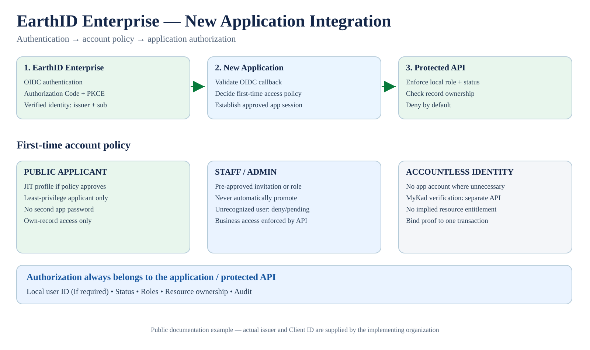
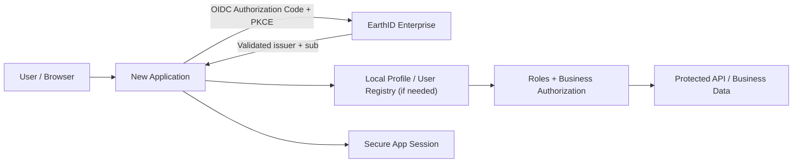
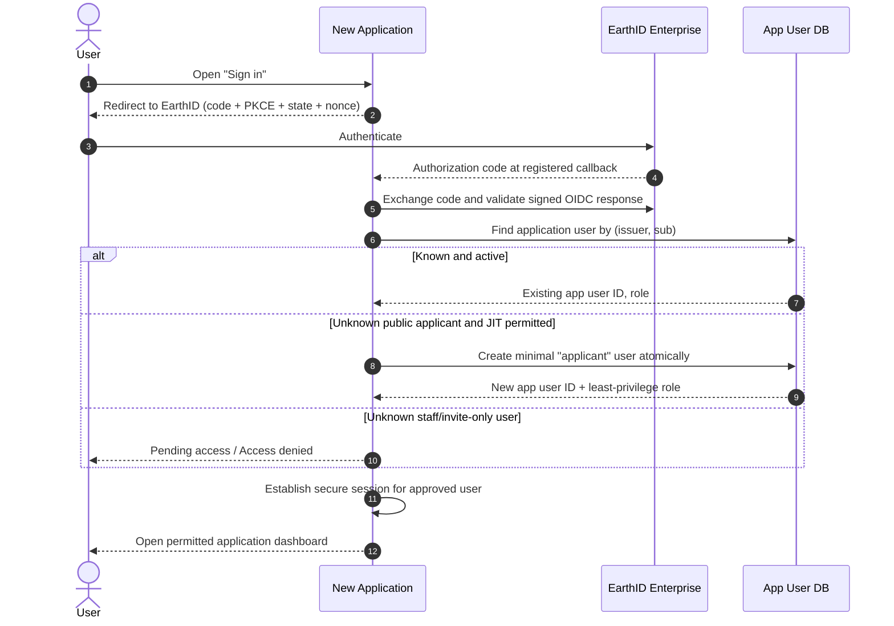
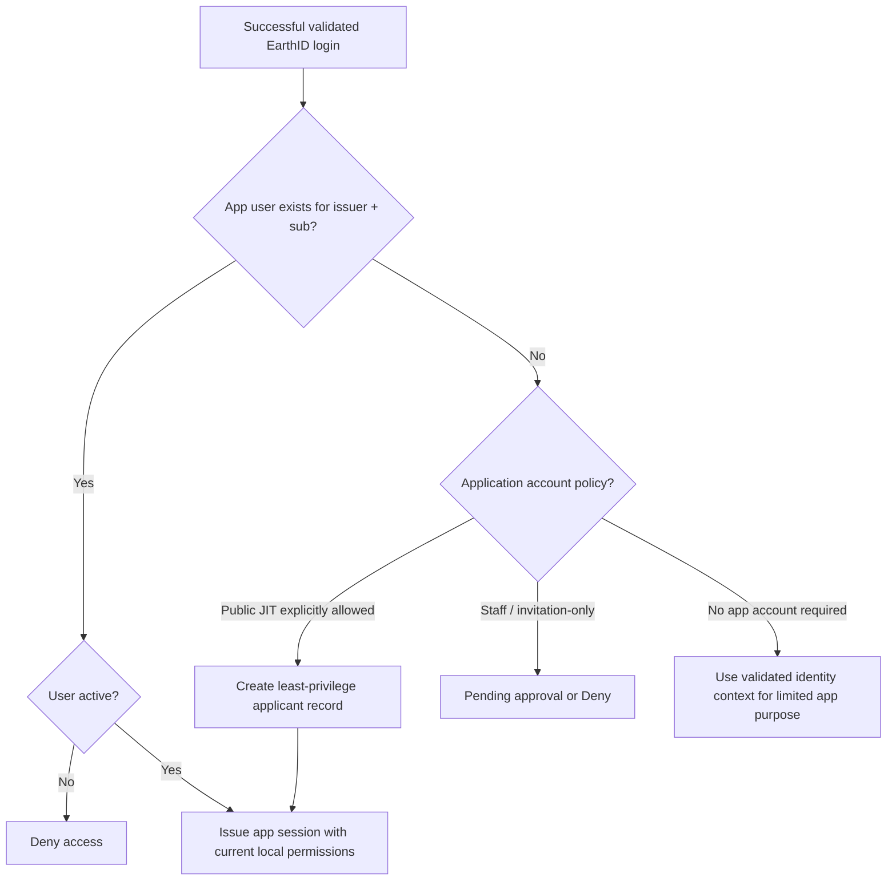

# Building a New Application with EarthID Enterprise (SSO-First)

**Audience:** developers building an application from scratch for an organization that operates EarthID Enterprise. There is **no legacy password database or existing local account to associate**.

**Recommendation:** Design authentication around EarthID Enterprise from day one. Implement **application-owned authorization and business data** from day one, too. Not having a legacy user table does **not** mean that the application should have no user identity, no role policy, or no access checks.

> **Division of responsibility:** EarthID Enterprise authenticates the person; the application validates OIDC, establishes an application session (or handles tokens in an approved public-client SPA), manages any local profile/permissions required, and **enforces authorization in its APIs**.

## Architecture at a glance



[Open architecture infographic](../assets/earthid-new-application-integration.svg).

## 1. Start by choosing your application model

| New application | Identity/account design | On first valid EarthID login | Authorization |
| --- | --- | --- | --- |
| **Public applicant portal** with persistent applications, bookings or records | App-owned minimal user record, keyed by unique `(issuer, sub)` | **Just-in-time (JIT) create** a least-privilege applicant profile, *if the organization explicitly approves this policy* | App checks that each record belongs to the user or their authorized representative |
| **Staff-only operational system** | App users and roles are **pre-approved / invited** by an administrator | Resolve an already-approved external identity; **deny or show Pending Access** if not provisioned | App checks staff role, assigned scope and business workflow |
| **Mixed public/staff portal** | Separate public applicant provisioning from staff approval | Public can receive applicant role under policy; **staff privileges must never be self-assigned** | API enforces both role and record-level policy |
| **Lightweight display app with no private records or persistent per-person state** | May not require its own user table | Validate OIDC and maintain approved application session / identity context | Still check access to any protected content; no implicit admin access |
| **One-time MyKad check only, no ongoing app account** | **Different EarthID capability** | Use the [MyKad Verification API](../verification/mykad/README.md), not a normal OIDC login | Transaction-specific authorization only |

**Key decision:** Choose whether users can **self-provision**, are **invited/pre-provisioned**, or are **blocked until approved**. Do this **before** building the login callback. A successful EarthID authentication is not permission to automatically create a privileged application account.

## 2. Registration and credentials

The **organization implementing EarthID Enterprise** provides and approves your actual configuration:

| Item | Confidential server-side app | Browser-only SPA |
| --- | --- | --- |
| **Issuer URL** | Organization provides | Organization provides |
| **Client ID** | Organization provides | Organization provides |
| **Client Secret** | Organization supplies **privately** | **None — do not request or embed one** |
| Client registration | Confidential OIDC web app | Public OIDC browser client |
| Flow | Authorization Code + **PKCE S256** | Authorization Code + **PKCE S256** |
| Callback URI | Exact registered HTTPS URI | Exact registered HTTPS URI |
| Token exchange | Backend to IdP | Browser to IdP (requires operator-approved CORS) |
| Session | Server-managed session / protected HttpOnly cookie | Browser client context; resource API validates bearer access token |

**Fictional hostname only:**

```dotenv
EARTHID_ISSUER=https://earthid.organization-domain.com
EARTHID_CLIENT_ID=organization-approved-client-id
# Confidential backend clients only:
EARTHID_CLIENT_SECRET=stored-privately-on-server
```

The actual Issuer URL **may include a path** and must match the OIDC discovery document's `issuer`. The example host is **not** a guaranteed live service. The implementing organization registers the exact callback URL and approves scopes and login methods.

Choose the relevant runnable example: [Next.js](../nextjs/README.md), [ASP.NET Core](../aspnet/README.md), [PHP/Laravel](../php/README.md) or [browser-only SPA](../spa/README.md). An existing application's [account-linking guide](existing-app-sso.md) is **not** the default starting point for a new application.

## 3. Recommended new-application architecture



**EarthID authenticates; your app owns permissions and business resources.** You may not need an old-style username/password login or `password_hash` column at all.

For a new app, a small local users table is often still valuable for **audit trails, record ownership, status, workflow assignments, notification preferences and business roles**. This table is **not** a second identity-provider login database.

### Suggested responsibility model

| Responsibility | Default owner |
| --- | --- |
| User authentication / SSO | EarthID Enterprise operated by the organization |
| OIDC registration / issuer / scopes / IdP login methods | Organization's EarthID administrator |
| OIDC callback validation | Vendor application, using a maintained OIDC library |
| User enrolment policy: public JIT or invite-only | Application owner / organization policy |
| Local user ID, business profile and role | Vendor application by default |
| Business record access, ownership and transactions | Vendor application **backend/API** |
| Central app eligibility/groups | May be centrally configured by organization **only under an explicit contract** |
| Application session, audit and access revocation | Vendor application |

## 4. Full first-time sign-in flow



**Important implementation detail:** The `Known and active` / `JIT permitted` paths proceed to an app session; the `Unknown staff` denial path **must stop** before creating an authorized session. A Mermaid sequence does not replace that branching rule.

### First-time decision tree



## 5. What gets stored locally?

For apps with persistent business records, an example **conceptual** model:

```text
application_users
  id                    local, stable application ID
  oidc_issuer           exact issuer from validated ID token
  oidc_subject          opaque sub from validated ID token
  display_name          optional, approved claim
  email                 optional, approved claim; NOT unique identity key
  status                active / pending / disabled
  role                  e.g. applicant, officer, reviewer (application-owned)
  created_at
  UNIQUE(oidc_issuer, oidc_subject)

business_records
  id
  owner_user_id         references application_users.id
  workflow_status
  other_business_fields

audit_events
  actor_user_id         application_users.id
  action
  resource_id
  timestamp
```

In a simple new application that supports only one EarthID issuer and one external identity per app account, keeping `issuer` and `sub` directly on the user table may be sufficient. For multiple identity providers, identity replacement, account recovery or multi-account linking, use a **separate external-identity mapping table**.

### Data-handling rules

- Use **`(issuer, sub)`**, not display name, NRIC, email or telephone number, as the primary external identity key.
- Do not invent an NRIC from `sub`, or assume it is a permanent identifier across issuers.
- Do not require users to create another password if EarthID is the application's intended sign-in provider.
- Store only business-required user data and claims the deployment actually supplies.
- Keep the account **disabled/pending** when not approved; don't let a valid EarthID login override local suspension.
- Use an atomic upsert/unique constraint for concurrent initial logins so duplicate local users cannot be created.
- Only copy an approved group/role from EarthID into local authorization under an explicit claim, governance, freshness and revocation policy.

## 6. JIT provisioning — when it is safe, and when it isn't

**JIT (Just-In-Time) provisioning** means creating a minimal local record **after a successfully validated OIDC login**, not creating an EarthID account.

Suitable example: a public applicant portal that allows any correctly authenticated user to register an application. The first login may create a local user with the role `applicant` and **zero pre-existing business records**.

**Not suitable as an unrestricted default:** an internal operations portal where any authenticated person could be treated as an official staff member. For this case, **pre-provision or require invitation/approval**; the first login can resolve but must not grant privileged access.

### Generic backend pseudocode

```text
identity = oidc.validateCallback(code, state, nonce, pkce)
key = (identity.iss, identity.sub)

db.transaction:
    user = db.findUserByExternalKey(key)

    if user is absent:
        if appPolicy.allowsPublicApplicantJIT:
            user = db.createUserIfAbsent(key, status="active", role="applicant")
        else:
            stopWithAccessPendingOrDenied()

    if user.status != "active":
        denyAccess()

    // A local role is app-owned, NOT inferred from OIDC login success.
    session.rotate()
    session.signIn(user.id)

redirectTo(approvedRelativeReturnPath)
```

In real code, validate inputs before the transaction, prevent races with uniqueness constraints, and avoid committing partial changes when approval is required. Use the framework's standard session/auth middleware and server-side policy checks.

## 7. Authorization — required even for an entirely new app

Don't ship an app that grants full access merely because the OIDC callback succeeded.

### Define role and resource rules first

| Example action | Applicant | Reviewer | Admin | Additional rule |
| --- | --- | --- | --- | --- |
| Submit own application | Yes | As allowed | As allowed | Must own the draft |
| View own application | Yes | As assigned | As policy allows | Record ownership / assignment |
| Review submitted applications | No | Yes | As policy allows | Assigned jurisdiction / workflow state |
| Approve final decision | No | Only if granted | Only if granted | Separation of duties and approval threshold |
| Manage local user roles | No | No | Restricted | Administrator authorization and audit |

This is an **example**, not a default EarthID role list. Role names, approval rules, business objects and central delegation must be defined by the application owner.

### Example API authorization

```text
GET /api/applications/456
  requireValidAppSessionOrApiAccessToken()
  user = getActiveLocalUser()
  record = findApplication(456)
  require(user.canRead(record))      # role + ownership / assignment
  return permittedFields(record)
```

A hidden “Approve” button or client-side route guard **does not** secure the backend. An API/resource server validates its expected access token (not an OIDC ID token), the correct issuer/audience/expiry, and enforces resource-specific policies.

## 8. New application: what should the User Profile show?

**Avoid reproducing a legacy “Associate / Re-associate / Unlink” panel automatically.** A new app with EarthID as its **primary, exclusive login method** may not have an alternative account it is safe to associate or detach.

A better default:

```text
My Profile
----------------------------------------------------
Sign-in provider       EarthID Enterprise
Signed-in identity     e***@organization-domain.com
Account status         Active
Application role       Applicant
Last sign-in           (only if recorded)
----------------------------------------------------
Manage profile details     [if app allows]
Sign out                     [app logout]
----------------------------------------------------
Your login is managed by your organization's EarthID.
Your application role and records are managed here.
```

If your new app genuinely supports multiple login providers or later needs identity recovery, add protected linking/replacement controls under an approved policy. **Do not expose Unlink when it would orphan the only login method.**

## 9. Sign-out, SSO and account lifecycle

- **Sign out from your app** ends the local session. It may **not** end EarthID's central SSO browser session.
- Global SSO logout is a separate, registered and tested feature if offered by the deployment.
- Token expiry is **not** equivalent to deleting the local user record.
- A disabled app user must lose access according to app session/authorization revocation policy, **even if EarthID login remains active**.
- User deletion, unlinking and local profile recovery are **application governance** matters; do not make destructive changes implicitly from an SSO login callback.

## 10. Use cases

| Scenario | Recommended onboarding | Why |
| --- | --- | --- |
| Public online services / permit requests | JIT applicant user with least privilege **if policy permits** | No second sign-up form required; app retains record history |
| Employee/internal operations portal | Approved staff user mapping/invitation before granting access | EarthID-authenticated public user ≠ authorized employee |
| Contractor/vendor portal | Explicit onboarding and organization/representative verification | Identity does not prove acting authority for a company |
| Public dashboard with no user-specific data | No persistent app user needed if no business identity required | Avoid unnecessary personal-data collection |
| One-time identity-gated appointment | [MyKad Verification API](../verification/mykad/README.md) | Transaction proof without ongoing app sign-in |

## 11. Minimum UAT before production

| ID | Test | Expected |
| --- | --- | --- |
| NEW-01 | First valid public applicant login | If approved, create exactly one active least-privilege applicant |
| NEW-02 | Second login for same external identity | Reuse same local app user ID; no duplicate |
| NEW-03 | Two concurrent first logins | Atomic uniqueness; at most one local user |
| NEW-04 | Unknown person attempts staff portal | Denied / pending; no staff role created |
| NEW-05 | Disabled app account authenticates successfully | App still denies access |
| NEW-06 | Tampered state, nonce, signature, issuer, audience, expired token | No app session |
| NEW-07 | Applicant tries another person's record ID | API denies access |
| NEW-08 | Applicant calls a reviewer/admin endpoint | API denies access |
| NEW-09 | App session expires | Fresh approved auth flow; local user record preserved |
| NEW-10 | App logout | Local session revoked; central SSO effects separately documented |
| NEW-11 | Unexpected missing name/email claim | Sign-in and minimal profile work if not strictly required |
| NEW-12 | Browser-only SPA | No Client Secret; API validates proper access token |
| NEW-13 | Staff/user removal | Privileged access revoked according to app policy |
| NEW-14 | Logs, errors and client bundle | No bearer tokens, secrets, NRIC or unintended personal data exposed |

## 12. FAQ for new projects

**Q: Must users register a new username and password?**  
**A:** Not if EarthID is your chosen sign-in method. Your app may create a small user profile to manage business data, without a second password. For public applicants, decide if JIT creation is allowed; staff access requires an explicit approval model.

**Q: Must every new app have a local user table?**  
**A:** No, but applications with persistent personal records, workflow roles, audit obligations or record ownership usually need a stable app-owned user/profile record or equivalent authoritative mapping.

**Q: Can we trust EarthID groups as application permissions?**  
**A:** Only when the implementing organization has agreed an explicit, reliable mapping/authorization contract. Even then, the API enforces record-level rules and revocation.

**Q: Does EarthID create local applicant/employee records automatically?**  
**A:** A normal OIDC login proves identity. **Your application implements any JIT provisioning, invitations or local account approval**. This guide does not claim a built-in EarthID endpoint creates your application's business users.

**Q: Can the public-client SPA skip authorization backend work?**  
**A:** No. A SPA can authenticate without an authentication backend, but APIs serving protected records still need real authorization and proper access-token checks.

**Q: Should we add Associate/Re-associate/Unlink buttons on day one?**  
**A:** Usually not for an EarthID-only new app with no legacy account. Show the identity provider and application role. Add protected linking controls only if multiple identities and a safe recovery policy exist.

**Q: What's different from the legacy-app guide?**  
**A:** Legacy systems **map to existing local users**. New systems **define an identity/provisioning policy from day one** and may create a minimal user **after** validated sign-in, without any old-password linking.

## Related documentation

- [New Public Service Portal case study](../case-studies/new-public-service-portal.md)
- [Authentication vs Authorization](authentication-vs-authorization.md)
- [Security Best Practices](best-practices.md)
- [Existing Application Integration](existing-app-sso.md)
- [Framework starters](../README.md)
- [MyKad Verification API](../verification/mykad/README.md)
- [Vendor readiness and deployment](vendor-readiness.md)

**All names/domains and roles in this document are fictional.** Deployment-specific capabilities, callback registration, user attributes and security settings must be confirmed with the organization running EarthID Enterprise. No live integration UAT is claimed here.
