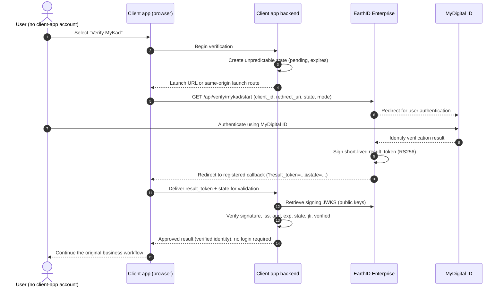

# EarthID Enterprise — MyKad Identity Verification via MyDigital ID

**Purpose:** Verify a Malaysian user's MyKad identity with MyDigital ID **without requiring the person to register or log in to the client application**.

This is **identity verification**, not the EarthID Enterprise OIDC single sign-on flow. The user still completes an interactive MyDigital ID authentication challenge. The relying application receives a short-lived, signed **verification result**, not an EarthID application session or OAuth access token.

The API contract represented here is **MyKad Verification API v2.0 (14 July 2026)**, cross-checked against a real Next.js relying-party integration available on 16 November 2026. The public examples use fictional organizations and identifiers and do not expose any customer implementation.

> **Scope of verification:** The observed relying party and the included API specifications support the request/response contract. We did not inspect the EarthID provider implementation in this review or run a live MyDigital ID transaction. The operator must confirm this contract and issue a registered client for your deployment.

## 1. Choose the right EarthID capability

| Requirement | EarthID Enterprise SSO | EarthID MyKad Verification API |
| --- | --- | --- |
| User must have an account in **your application** | Depends on your application's policy | **No** |
| User must complete an identity-provider authentication step | Yes | **Yes — MyDigital ID** |
| Primary purpose | Sign in to an application / single sign-on | Prove the identity attributes of the person completing a one-time challenge |
| Main result | OIDC authorization code and tokens | Signed `result_token` JWT returned to your callback |
| Creates an EarthID SSO login session for your app | OIDC sign-in | **Do not assume so** |
| Requires your client app to create a user account | Application-dependent | **No** |
| Suitable uses | Ongoing authenticated application access | Pre-registration checks, identity confirmation before a transaction, accountless appointment flows |

**This is not a silent NRIC lookup.** The person must actively authenticate with MyDigital ID. Verification of identity does **not** prove ownership, authority to represent an organization, or entitlement to a business resource.

## 2. Architecture and verification flow



**Browser behavior:** `/api/verify/mykad/start` is a **navigation/redirect endpoint**. It does not return a successful JSON body. Navigate the browser or popup to it. A backend is **recommended for the relying application** to store state, validate JWTs, prevent replay and establish any transaction-scoped proof; the **end user** still needs no account or application login.

## 3. Registration: what the implementing organization provides

The organization implementing EarthID Enterprise must create an active, **MyKad Verification API** client registration. This is distinct from an ordinary OIDC SSO client registration.

| Value | Required | Supplied by |
| --- | --- | --- |
| **EarthID service base URL** | Yes | Implementing organization |
| **Result token issuer** (exact `iss` value) | Yes | Implementing organization |
| **Client ID** | Yes | Implementing organization |
| **Registered redirect URI** | Yes | Vendor provides URI; organization approves exact string |
| **JWKS URL** | Yes | Implementing organization / API contract |
| **Client Secret** | **No for v2 start request** | Not part of the v2.0 start contract |

**Fictional example:**

```text
EarthID service: https://earthid.organization-domain.com
Expected result-token issuer: https://earthid.organization-domain.com/api/earthid
Client ID: example-verification-client
Callback URL: https://app.organization-domain.com/verify/callback
JWKS URL: https://earthid.organization-domain.com/api/verify/mykad/jwks
```

The issuer above is an **illustrative string**, not a guaranteed issuer format. Use the exact issuer agreed with your organization. Callback URI registration is an exact match: scheme, hostname, port, path and trailing slash must match. Use HTTPS in production.

**Do not substitute the OIDC SSO integration's Client Secret or token endpoint for this verification API.** The newer v2.0 verification specification does not require a Client Secret on the start request. An older v1 specification described an NRIC-and-secret flow; that is **not** the recommended new contract.

## 4. API: start verification

```http
GET https://earthid.organization-domain.com/api/verify/mykad/start
```

Query parameters for **new integrations**:

| Parameter | Required | Notes |
| --- | --- | --- |
| `client_id` | Yes | Organization-issued MyKad Verification Client ID |
| `redirect_uri` | Yes | Exact, registered HTTPS callback |
| `state` | Yes | Unpredictable, unique, short-lived correlation value generated by your application |
| `mode` | No | `popup` or `redirect`; default documented as `popup` |
| `nric` | **No** | Deprecated legacy comparison parameter; do not send in new integrations |
| `client_secret` | **No** | **Not included** in the v2.0 start request |

Example (line breaks shown only for readability):

```text
https://earthid.organization-domain.com/api/verify/mykad/start
  ?client_id=example-verification-client
  &redirect_uri=https%3A%2F%2Fapp.organization-domain.com%2Fverify%2Fcallback
  &state=4b40d2f8dbe34a7f8ac0960c12baba68
  &mode=popup
```

**Expected response:** A browser redirect to the MyDigital ID verification journey. **Not** `{ "success": true }`, and not a synchronous NRIC-verification JSON lookup. Once completed, EarthID returns to the **registered callback**.

### Popup or full-page redirect?

- **Popup:** convenient for staying on an existing form; use a callback page on the same origin as the opener when possible; notify only after server-side verification.
- **Full-page redirect:** useful on mobile browsers and when popups are blocked; preserve the pending transaction server-side and restore the business page after verification.

Do not rely on cross-origin `postMessage` from EarthID. Your callback is the correct place to send a tightly scoped notification to the opener using the **exact origin**, after the server has checked the result.

## 5. API: what EarthID returns

### Successful callback

```text
https://app.organization-domain.com/verify/callback
  ?result_token=eyJhbGciOiJSUzI1NiIs...
  &state=4b40d2f8dbe34a7f8ac0960c12baba68
```

The `result_token` is a **signed JWT**. Example of a **decoded** payload (sample values only; **do not trust anything until verified**):

```json
{
  "iss": "https://earthid.organization-domain.com/api/earthid",
  "aud": "example-verification-client",
  "sub": "900101010000",
  "iat": 1794000000,
  "exp": 1794000300,
  "jti": "example-one-time-token-id",
  "state": "4b40d2f8dbe34a7f8ac0960c12baba68",
  "verified": true,
  "comparison_performed": false,
  "nric": "900101010000",
  "name": "Example Person"
}
```

| JWT claim | Type | Meaning |
| --- | --- | --- |
| `iss` | string | Exact EarthID result-token issuer supplied by organization |
| `aud` | string | Registered verification `client_id` |
| `sub` | string | Current documented implementation uses compact verified NRIC; **do not assume a permanent general-purpose account ID** |
| `iat` / `exp` | integer | Issued-at and expiry, Unix seconds; use `exp` rather than assuming a constant validity period |
| `jti` | string | Unique token identifier; reject reuse with a durable, atomic store |
| `state` | string | Must match the application's pending challenge |
| `verified` | boolean | Must be **strictly `true`** for successful MyDigital ID verification |
| `comparison_performed` | boolean | `false` for the recommended no-NRIC start flow |
| `nric` | string | Verified MyKad number, **12 digits without dashes** |
| `name` | string | Full name when available; handle missing value |
| `matched` | boolean, optional | **Legacy only**; omitted in new flows, **not a success criterion** |

**Important:** A signed token confirms the identity attributes it asserts. If your application already holds an expected NRIC, normalize the two values and compare **after** verifying the JWT. A mismatch is an application-level result, not proof that the person's MyDigital ID authentication failed.

### Failed callback

```text
https://app.organization-domain.com/verify/callback
  ?error=verification_failed
  &error_description=Authentication+failed.+Please+try+again.
  &state=4b40d2f8dbe34a7f8ac0960c12baba68
```

Documented v2.0 error codes:

| Code | Meaning / action |
| --- | --- |
| `verification_failed` | User did not finish successfully or the verification operation failed; offer retry |
| `invalid_nric` | Invalid **legacy** input (deprecated; should not occur when new integrations omit NRIC) |
| `mydigitalid_no_nric` | No valid NRIC returned from MyDigital ID; cannot treat as verified |

Errors can include an `error_description`. Other failure conditions (unregistered callback, expired state, invalid token, revoked client, network interruptions) must be handled defensively, but their exact callback/error contract should be confirmed with the operator.

### Public signing key endpoint

```http
GET https://earthid.organization-domain.com/api/verify/mykad/jwks
```

This returns a JWK Set containing public RSA signing keys (`keys[]` with `kid`, `kty`, `n`, `e` and related metadata). Select by JWT `kid`, verify the **RS256** signature, and handle key rotation. The JWKS contains **public keys**, not secrets.

## 6. What your application must validate

**Never trust `result_token` merely because it arrived on an allowed callback URL.** Before using any identity attribute:

1. Validate the JWT's **RS256 signature** against the EarthID verification JWKS; do not accept `none` or arbitrary algorithms.
2. Verify the exact **issuer (`iss`)** and **audience (`aud = client_id`)**.
3. Verify token time claims, including **`exp`**, and reject expired or otherwise invalid tokens.
4. Verify **`state`** against a pending, unexpired transaction belonging to the correct browser or workflow.
5. Reject replay: atomically mark **`jti`** as used for at least the token's remaining validity.
6. Require **`verified === true`**, and validate the returned `nric` as a compact 12-digit string.
7. If your transaction expects a particular NRIC, compare with **`nric`** on your backend.
8. Consume the pending transaction **once**, then continue your application's own workflow.

See the [Node.js JWT validation example](examples/) for executable signature and claim validation. **Never use an in-memory Set as the only replay-control store in a multi-instance deployment**; use a shared database/Redis operation with atomic consume/uniqueness.

**The verification result is not a general API bearer token or an app login.** Do not treat it as proof of company representation, property ownership, a valid licence, or a permanent identity session.

## 7. How to use it without application sign-up/login

A public application can start a **transaction-scoped verification** on a user's behalf:

1. Browser opens a public form; **no username/password or registration**.
2. App backend generates a random `state` and stores a pending transaction (e.g., 10-minute TTL).
3. Browser opens the EarthID start URL via popup or redirect; the **user authenticates with MyDigital ID**.
4. EarthID sends the result JWT to the registered callback.
5. App backend validates it and marks the transaction complete. It may issue a **short-lived, HttpOnly, SameSite application cookie** bound to the verified transaction.
6. The user continues the original operation (e.g., an appointment). The client app does not need to create a login account.

The inspected reference application uses a **10-minute verification attempt** and a **15-minute app-specific verified session**; those durations are **not part of the EarthID API contract**. The session lifetime and application-level permissions are chosen by the vendor. The user's identity must never be accepted just because the browser sends an NRIC string.

### Verified identity versus resource authorization

A practical workflow can be:

```text
MyDigital ID verifies a person -> EarthID signs verified NRIC
      -> Your application identifies the person
      -> Your application checks a separate business record / entitlement
      -> Only then allows the requested operation
```

Example: a verified NRIC lets an appointment application search *its own* records, but the application must separately prove the record belongs to or can be accessed by that person. Verification does not automatically prove ownership or authorizations.

## 8. Example use cases and decision outcomes

| Scenario | How to use verification | Follow-up requirement |
| --- | --- | --- |
| **Accountless appointment booking** | Verify identity before granting a one-time booking transaction | Validate appointment eligibility, capacity and business records separately |
| **Retrieve existing appointments** | Verify the person, then look up appointments scoped to verified NRIC | Enforce record-level restrictions server-side |
| **Identity check before submitting a form** | Bind one verified result to a single submission | Keep transaction state, audit reference and expiration |
| **Expected MyKad comparison** | Verify first, then compare returned `nric` to the application's expected NRIC | Reject mismatch locally; no need to send NRIC in start request |
| **Document signing invitation** | Confirm that recipient completing the action holds a verified identity | Signing authority, consent and document authorization remain separate |
| **Company or representative workflows** | Verify the *individual* signing/acting | Verify role and representation through your own business registry |
| **User cancels authentication** | Receive error or incomplete callback | Do not mark verified; offer retry |
| **Expired/replayed callback token** | Reject token | Create a fresh verification attempt |
| **Identity verified but business data missing** | Treat identity result as valid, but no matching resource | Switch to a separate declaration/review flow |

## 9. Integration boundaries and operational cautions

- **No client app sign-up is required; MyDigital ID authentication is still mandatory.**
- **Do not use the unrelated simulated MyDigital ID session endpoint as the real API.** Testing/mocks must be explicitly disabled or isolated in production.
- **Do not put raw NRIC, full signed result tokens or Client Secrets in public URLs, screenshots, analytics, logs or localStorage.** The v2 callback itself carries the result JWT in a query string; prevent URL/log retention where possible, set `Referrer-Policy: no-referrer`, promptly clear browser history/query parameters after delivery, and never place third-party scripts on the token-processing callback.
- **No Client Secret in v2 verification start requests**; older documentation described a different, deprecated arrangement.
- Reject mismatched `state` and unauthorized callback origins. For popup notifications validate `event.origin === window.location.origin` and carry **only an approved result**, not an unverified claim.
- Verification does not equal SSO. It does not automatically create a long-lived EarthID login session, issue an OIDC access token, or grant application roles.
- All sample domains and person details in this public document are fictional. The implementing organization supplies and approves the real endpoint URLs, issuer, Client ID, and redirect URI.

## 10. UAT and supporting examples

- [Developer UAT checklist](UAT.md)
- [Server-side JWT validation example](examples/)
- [EarthID Enterprise general integration README](../../README.md)

**Validation boundary:** This guide documents behavior supported by the newer integration specification and the inspected relying-party code. It does not claim that provider-side code, live MyDigital ID connectivity, or production transactions were tested.
